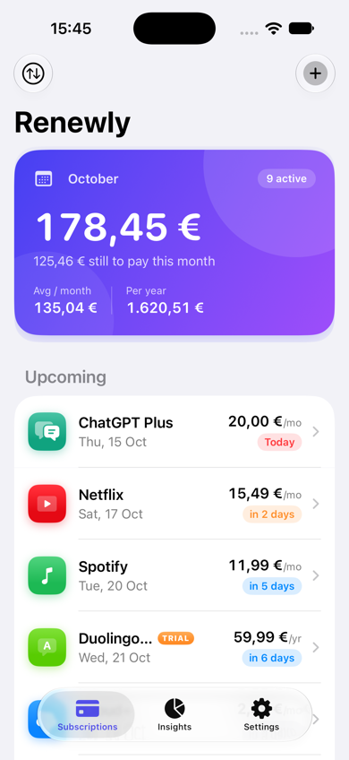
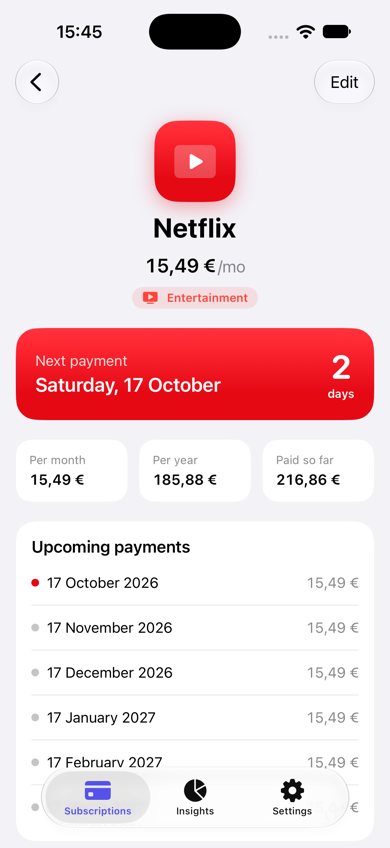
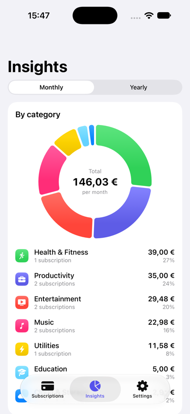
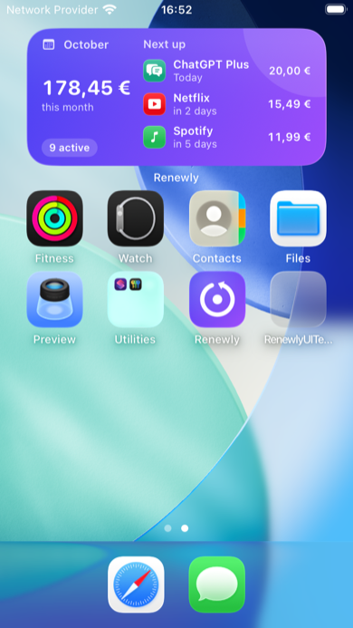
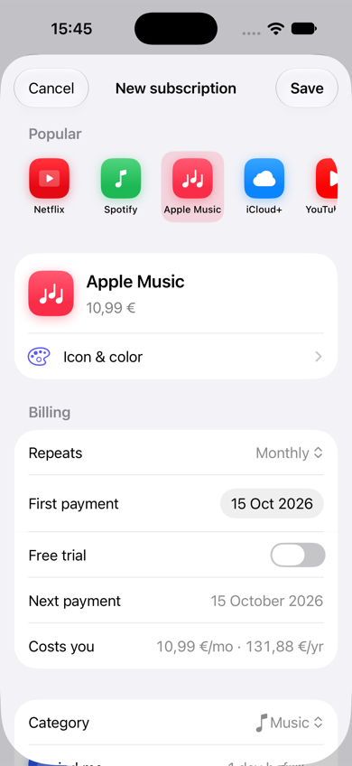
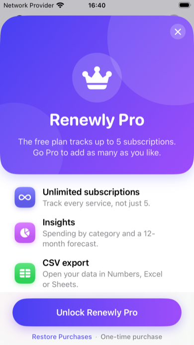
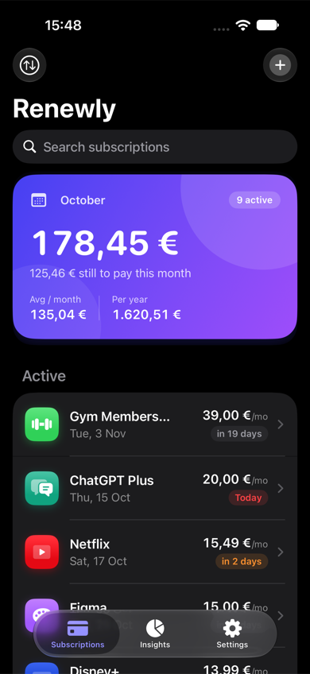

# Renewly

**Know what renews, before it charges.** Renewly is an iPhone app for keeping track of subscriptions: what you pay, when each one renews, and where your money goes.

  
  
  
  

## Features

- **Dashboard:** this month's total, what's still left to pay, and your monthly and yearly run-rate, above a list of upcoming renewals with colored countdowns.
- **Quick add:** pick from 24 popular services (Netflix, Spotify, iCloud+ …) to fill in name, price, cycle, icon and color, or enter your own.
- **Reminders:** a notification before every charge, with a "cancel now" nudge for free trials.
- **Subscription details:** next payment countdown, cost per month and year, amount paid so far, and the next six payment dates.
- **Insights (Pro):** spending by category, a 12-month forecast and your biggest costs.
- **Home Screen widget:** small and medium sizes showing this month's total and what renews next.
- **Pause, search, sort, CSV export (Pro)**, dark mode, and layouts tuned down to the 4.7" iPhone SE.
- **Private by design:** everything stays on the device. No account, no tracking, no bank access.

  
  
  

## Free and Pro

The free plan tracks up to 5 subscriptions with reminders and the widget. **Renewly Pro** is a one-time in-app purchase that unlocks unlimited subscriptions, Insights and CSV export.

## Tech

- SwiftUI and SwiftData, iOS 17+, iPhone
- Swift Charts for Insights
- StoreKit 2 for the Pro unlock, with a local `Renewly.storekit` configuration for testing
- WidgetKit extension sharing the data store through an App Group
- Local notifications via `UserNotifications`

| Folder | Contents |
| --- | --- |
| `Renewly/` | App: views, notification scheduler, Pro store |
| `Shared/` | Model and data store, compiled into the app and the widget |
| `RenewlyWidget/` | Home Screen widget |
| `RenewlyUITests/` | UI tests for the free limit, paywall and purchase |

## Building

Open `Renewly.xcodeproj` in Xcode, choose your own team under *Signing & Capabilities* for the app and widget targets, and run on a simulator or device.

## Copyright

Copyright © 2026 Rok Dobravec. All rights reserved.

This repository is public so the code can be viewed. No license is granted to copy, modify, distribute or publish this code or app, in whole or in part, without written permission.
